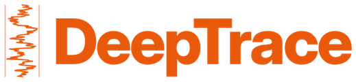

  

  <strong>AI-assisted well-log digitization for oil and gas technical teams.</strong> 
  Legacy TIFF and PDF scans in, reviewable, depth-calibrated LAS 2.0 out.

  <a href="https://deeptrace.co"><b>Website</b></a> ·
  <a href="https://deeptrace.co/demo">Demo</a> ·
  <a href="https://deeptrace.co/specs">Technology</a> ·
  <a href="https://deeptrace.co/case-study">Case study</a> ·
  <a href="https://deeptrace.co/survey">Request access</a> ·
  <a href="https://deeptrace.co/contact">Contact</a>

<picture>
  <source media="(prefers-color-scheme: dark)" srcset="https://raw.githubusercontent.com/DeepTraceCo/.github/main/profile/assets/hero-dark.svg">
  <source media="(prefers-color-scheme: light)" srcset="https://raw.githubusercontent.com/DeepTraceCo/.github/main/profile/assets/hero-light.svg">
  
</picture>

## Legacy well logs, ready for analysis

Much of the well-log record still exists only as scanned images that petrophysical software cannot read.
DeepTrace prepares those logs for analysis. Computer vision and multiple frontier AI models do the reading,
technical experts review the result, and the output is depth-calibrated LAS 2.0 that fits established
petrophysical workflows. The original imagery stays available throughout, so every value can be checked in context.

<table>
  <tr>
    <td width="50%" valign="top">
      <h3>Well-log digitization</h3>
      Convert scanned curves into numerical data with depth and measurement scales, then export LAS 2.0 for use in petrophysical software.
    </td>
    <td width="50%" valign="top">
      <h3>Structured log annotation</h3>
      Identify curve tracks, headers and supporting text. Review and adjust the selected regions against the original scan.
    </td>
  </tr>
  <tr>
    <td width="50%" valign="top">
      <h3>AI-assisted data extraction</h3>
      Multiple frontier AI models help read well identifiers, curve names, units and scale information from complex legacy documents.
    </td>
    <td width="50%" valign="top">
      <h3>Expert review and collaboration</h3>
      Keep source documents and processing results together in shared workspaces, where technical teams inspect, correct and review their logs.
    </td>
  </tr>
</table>

## How it works

<picture>
  <source media="(prefers-color-scheme: dark)" srcset="https://raw.githubusercontent.com/DeepTraceCo/.github/main/profile/assets/workflow-dark.svg">
  <source media="(prefers-color-scheme: light)" srcset="https://raw.githubusercontent.com/DeepTraceCo/.github/main/profile/assets/workflow-light.svg">
  
</picture>

<b>The seven steps</b>

 

1. **Upload the raster.** Start with a scanned TIFF or PDF well log.
2. **Auto-annotation.** Locate log tracks, headers and text regions for review.
3. **Read with OCR.** Read well identifiers, curve names, units and printed scale values.
4. **Check the scales.** Confirm depth references, linear or logarithmic scales, and the neutron calibration basis.
5. **Digitize the curves.** Trace measurements against the calibrated depth and curve scales.
6. **Review the overlay.** Compare traces with the source and review gaps before accepting the output.
7. **Export LAS 2.0.** Named curves, units and depth values, with missing samples kept as NULL.

## Technology

A browser-based platform combining computer vision, multiple frontier AI models and scientific computing.

  
  
  
  
  
  
  
  
  

| In | Out | Review |
| --- | --- | --- |
| TIFF and PDF well logs, multi-page source files | LAS 2.0 curves with well identifiers, units and scales | Source imagery alongside the results, inspected and corrected by the user |

## Roadmap

<picture>
  <source media="(prefers-color-scheme: dark)" srcset="https://raw.githubusercontent.com/DeepTraceCo/.github/main/profile/assets/roadmap-dark.svg">
  <source media="(prefers-color-scheme: light)" srcset="https://raw.githubusercontent.com/DeepTraceCo/.github/main/profile/assets/roadmap-light.svg">
  
</picture>

Building on well-log digitization, the next phases connect analysis, comparison across wells and carbon-credit workflows,
with technical specialists staying in control of every decision.

## Work with us

Share your log formats, archive size and intended use, and we can scope an evaluation around your data
and the requirements of your technical team.

**[Request access →](https://deeptrace.co/survey)** &nbsp; · &nbsp; **[Contact us](https://deeptrace.co/contact)**

---

© 2026 DeepTrace Subsurface Co · <a href="https://deeptrace.co">deeptrace.co</a> · Graphics show illustrative data.

